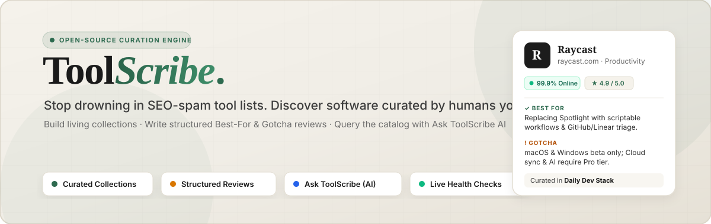
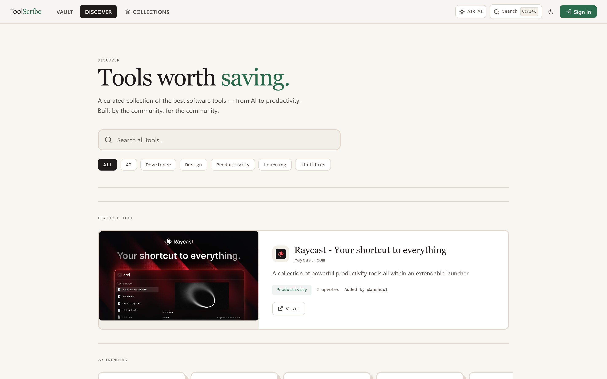
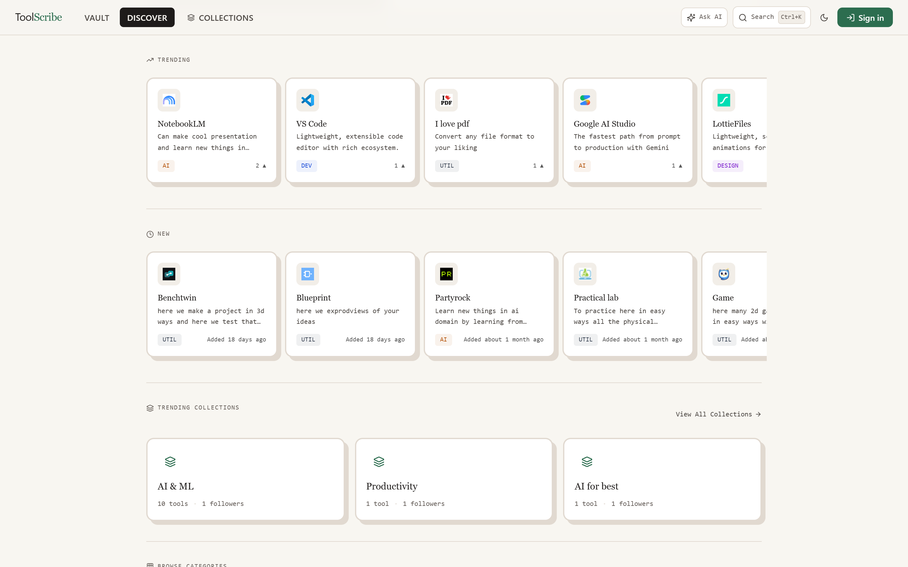
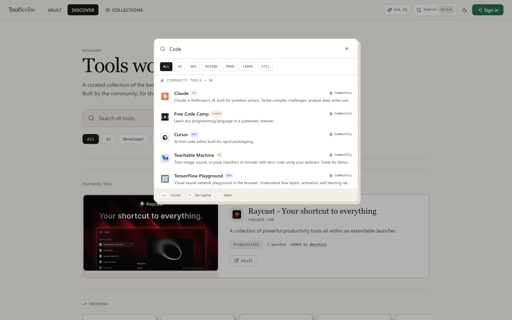
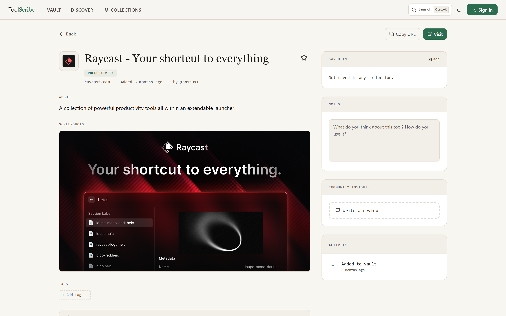
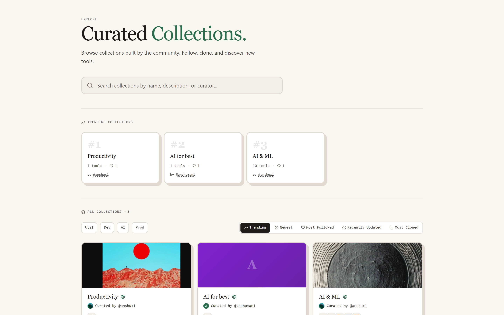
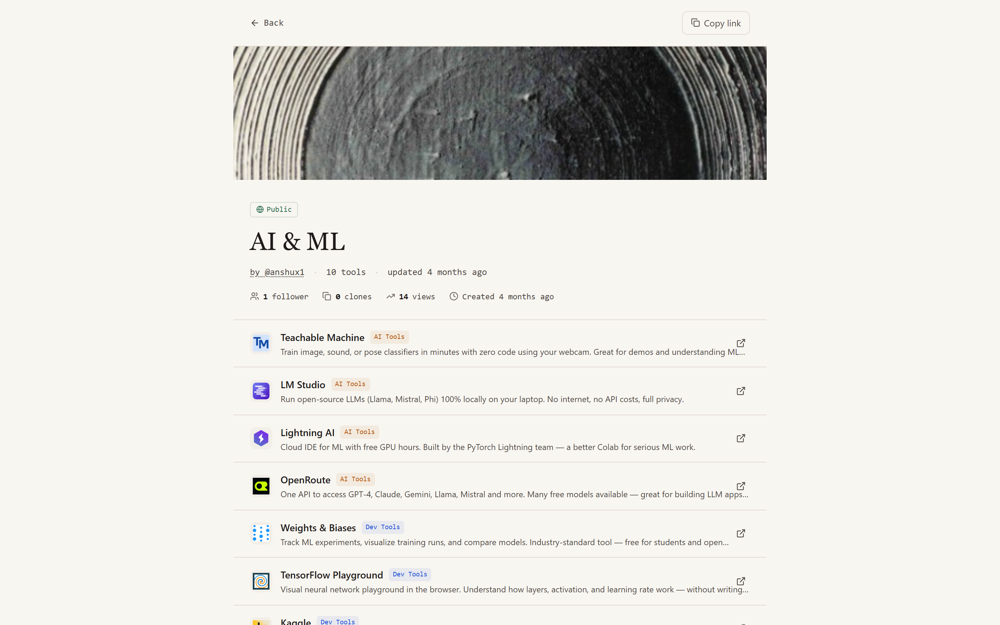
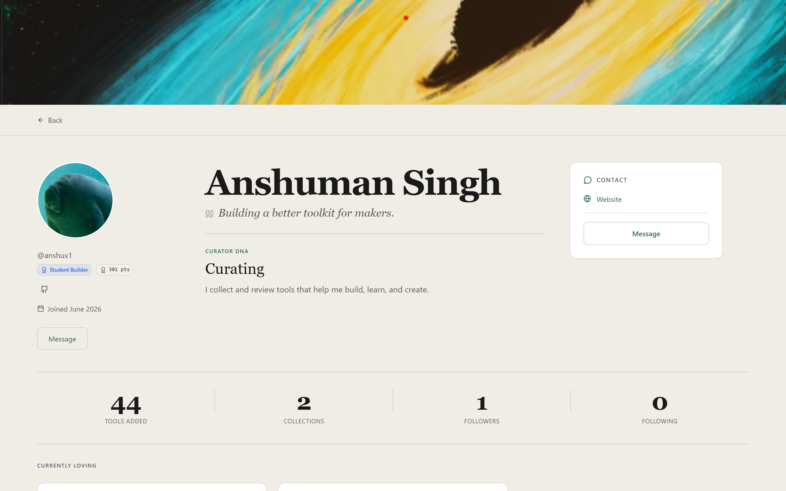
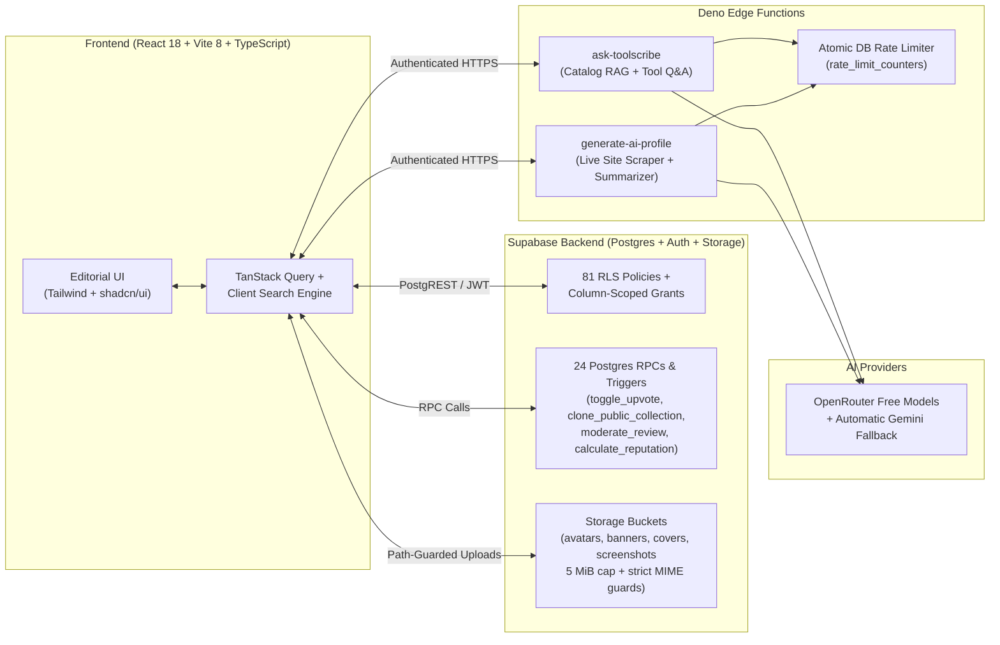

<div align="center">



<br />

# ToolScribe

**Stop drowning in SEO-spam "Top 50 Tools" blog posts.**  
Discover, evaluate, and organize software curated by builders whose taste you actually trust — backed by structured reviews, live uptime checks, and an AI assistant grounded in real community data.

[](https://github.com/anshux1098/Tool-scribes/actions)


[](./LICENSE)

[**Why ToolScribe?**](#-why-toolscribe) · [**Product Tour**](#-product-tour) · [**Key Features**](#-key-features) · [**Architecture & Security**](#️-architecture--security-model) · [**Quick Start**](#-quick-start) · [**Contributing**](#-contributing)

---



</div>

---

## 💡 Why ToolScribe?

Finding great software today is broken in three ways:

1. **Search engines reward affiliate spam, not quality.** Searching *"best developer tools"* or *"best AI tools"* returns generic listicles written by content farms ranking whoever pays the highest commission.
2. **Star ratings without context are useless.** Knowing a tool has `4.7 ★` doesn't tell you whether the free tier is a 3-day trial trap, what the hidden gotchas are, or what workflow it actually excels at.
3. **Browser bookmarks are where tools go to die.** You bookmark a promising tool on X or Hacker News, forget its name two weeks later, and never open it again.

**ToolScribe fixes all three** by combining a **personal software vault**, **structured community reviews**, and **taste-driven curator graphs** into a single editorial platform:

| Problem | Generic Directories & Bookmarks | The ToolScribe Way |
| :--- | :--- | :--- |
| **Discovery** | Paid placements & SEO listicles | **Time-decayed trending algorithm** + human curators you follow |
| **Evaluation** | Vague 1–5 star ratings & marketing copy | **Structured 3-Part Reviews**: *Best For*, *Gotchas*, and *Free Tier Reality* |
| **Organization** | Dead browser bookmark folders | **Personal Vault** with private notes, custom tags, visit tracking & a **Dust Collector** that resurfaces forgotten saves |
| **Sharing Stacks** | Static Notion pages or Markdown lists | **Living Collections** with follower feeds, cover art, and **1-click stack cloning** |
| **Link Rot** | 404 dead links & abandoned side projects | **Automated Uptime & Health Badges** + community-voted alternatives |
| **AI Search** | Hallucinated tools that no longer exist | **Ask ToolScribe (`Ctrl+Shift+K`)** — grounded strictly in the live, health-checked catalog |

---

## 📸 Product Tour

### 1. Editorial Discovery & Instant Command Palette (`Ctrl+K`)

Browse time-decayed **Trending**, **Rising**, and **Newest** shelves, filter immediately by category, or hit `Ctrl/Cmd + K` from anywhere in the app to search across your personal vault, the community catalog, and public collections in milliseconds.

| Trending & Editorial Shelves | Global Command Palette (`Ctrl+K`) |
| :---: | :---: |
|  |  |

---

### 2. Deep Tool Profiles, Structured Reviews & Live Health Monitoring

Every tool page goes beyond a simple link: view automated screenshots, neutral AI-generated summaries, **live uptime health badges**, community-voted **alternatives**, personal vault notes, and **structured reviews** that highlight *Best For*, *Gotchas*, and *Free Tier* limits.

<div align="center">
  
</div>

---

### 3. Curated Collections Hub & 1-Click Stack Cloning

Curators bundle tools into thematic workflows (*"Local-First AI Stack"*, *"Indie Hacker Design Kit"*, *"Rust CLI Essentials"*). Anyone can **follow** a collection for updates or **clone** an entire public collection into their own workspace in a single atomic transaction.

| Collections Hub (`/collections`) | Public Collection View (`/c/:uuid`) |
| :---: | :---: |
|  |  |

---

### 4. Editorial Curator Profiles (`/u/:username`)

Your profile is your software portfolio. Showcase your **Curator Badge**, reputation score, **Currently Loving** shelf (up to 3 pinned daily-driver tools), **Featured Collection**, recent structured reviews, and real-time curation timeline.

<div align="center">
  
</div>

---

## ✨ Key Features

### 🔍 Discovery & AI Intelligence
- **Time-Decayed Trending Engine** — Ranks tools dynamically using `(upvotes × 3 + saves × 2) / (hours_since_added + 2)^1.5` so fresh breakthroughs compete fairly with established favorites.
- **Ask ToolScribe (`Ctrl/Cmd + Shift + K`)** — Natural-language AI assistant powered by Supabase Deno Edge Functions (OpenRouter + Gemini fallback) that recommends tools strictly from the verified catalog and answers context-aware questions on any tool page.
- **Collaborative Recommendations** — Surfaces *"Users who saved this also saved…"* using real vault co-occurrence patterns (`get_tool_recommendations` & `get_vault_recommendations` RPCs).
- **Community-Voted Alternatives** — Suggest and upvote drop-in replacements for any tool (e.g., open-source or self-hosted alternatives).

### 🗄️ Personal Vault & Curation
- **Personal Software Vault** — Save tools, attach private markdown notes, organize with personal tags, filter favorites, and track how often you actually launch each tool.
- **The Dust Collector** — Automatically identifies tools sitting untouched in your vault for 30+ days so you can either put them to work or prune the clutter.
- **Public & Private Collections** — Customize collection covers, descriptions, and visibility; share canonical `/c/:uuid` links or clone community stacks.

### 🤝 Community Trust, Health & Moderation
- **Structured 3-Part Reviews** — Enforces high-signal feedback (*Best For*, *Gotcha*, *Free Tier* notes + star rating) with full admin moderation (`active` / `hidden` / `removed`).
- **Automated Tool Health Badges** — Tracks HTTP status and availability (`online`, `degraded`, `offline`) so dead links are caught early.
- **Guided Tool Submissions** — Auto-fetches metadata, checks for URL/domain duplicates, captures live site screenshots, and queues submissions for moderator approval.
- **Reputation & Curator Badges** — Database triggers automatically compute curator reputation from approved tool submissions, active reviews, and followers.

---

## 🏗️ Architecture & Security Model

ToolScribe is built as a fast, type-safe React SPA backed directly by **Supabase Postgres**, **Row-Level Security (RLS)**, **`SECURITY DEFINER` Postgres RPCs**, and **Deno Edge Functions**.



### Engineering & Security Highlights
- **Column-Scoped Privilege Hardening**: `profiles`, `reviews`, and `tools` enforce strict column-level `GRANT UPDATE` privileges in Postgres. Users cannot tamper with server-owned fields like `reputation_score`, `upvotes`, `moderation_status`, or `added_by`.
- **Drift-Proof Upvotes & Clones**: Upvotes are toggled via the atomic `toggle_upvote(tool_id)` RPC (deriving counts from `count(*)` rather than client-supplied deltas), and collection cloning runs in a single transactional `clone_public_collection()` RPC.
- **SSRF & Storage Path Guards**: Edge functions validate target URLs against private/loopback IP ranges before scraping, and client storage uploads enforce strict user-scoped path guards (`src/lib/storage-path.ts`) and 5 MiB image-only MIME constraints.
- **Database-Backed Edge Rate Limiting**: AI endpoints track per-user token buckets atomically in Postgres (`rate_limit_counters`) rather than ephemeral in-memory maps.

---

## 🛠️ Tech Stack

| Layer | Technology |
| :--- | :--- |
| **Frontend Framework** | React 18, TypeScript 5, Vite 8, React Router 6 |
| **Styling & Design System** | Tailwind CSS, shadcn/ui (Radix UI primitives), Framer Motion, Lucide Icons, Playfair Display + Inter |
| **Data Fetching & Forms** | TanStack Query v5, React Hook Form, Zod validation |
| **Database & Auth** | Supabase (PostgreSQL, GoTrue Auth, Row-Level Security, Supabase Storage) |
| **Serverless Edge Functions** | Supabase Edge Functions (Deno runtime) — `ask-toolscribe`, `generate-ai-profile` |
| **AI Providers** | OpenRouter (`openrouter/free` with model fallback chain) + Google Gemini API fallback |
| **Testing & Quality** | Vitest, React Testing Library, Playwright, ESLint, TypeScript project references (`tsc -b`) |

---

## 🚀 Quick Start

### Prerequisites
- **Node.js** `20.19+` or `22.12+`
- A **[Supabase](https://supabase.com)** project (free tier works out of the box)

### 1. Clone & Install

```bash
git clone https://github.com/anshux1098/Tool-scribes.git
cd Tool-scribes
npm install
cp .env.example .env
```

### 2. Configure Environment Variables

Open `.env` and add your Supabase project URL and publishable/anon key:

```env
VITE_SUPABASE_URL=https://your-project-ref.supabase.co
VITE_SUPABASE_PUBLISHABLE_KEY=your-supabase-anon-or-publishable-key
```

### 3. Database & Schema Setup

The [`supabase/`](./supabase/README.md) directory contains the complete database reference and migration history:

1. Apply the base schema and functions from [`supabase/schema_structure.sql`](./supabase/schema_structure.sql) and [`supabase/functions.sql`](./supabase/functions.sql), or push the applied migrations in [`supabase/migrations/`](./supabase/migrations/) via the Supabase CLI (`npx supabase db push`).
2. Promote your user account to `admin` to unlock the moderation dashboard (`/admin`):
   ```sql
   insert into public.user_roles (user_id, role)
   values ('YOUR_AUTH_USER_UUID', 'admin');
   ```
3. *(Optional)* Deploy the AI Edge Functions and configure provider secrets:
   ```bash
   npx supabase functions deploy ask-toolscribe --project-ref YOUR_PROJECT_REF --no-verify-jwt
   npx supabase functions deploy generate-ai-profile --project-ref YOUR_PROJECT_REF --no-verify-jwt
   npx supabase secrets set OPENROUTER_API_KEY=your_openrouter_key GEMINI_API_KEY=your_gemini_key
   ```

### 4. Start Developing

```bash
npm run dev          # Starts Vite dev server on http://localhost:8080
```

### Available Scripts

| Command | Description |
| :--- | :--- |
| `npm run dev` | Start local development server with HMR on port `8080` |
| `npm run typecheck` | Run strict TypeScript project reference check (`tsc -b --noEmit`) |
| `npm run lint` | Run ESLint across the codebase |
| `npm test` | Run the Vitest unit & integration test suite (79 tests across 11 suites) |
| `npm run build` | Typecheck and build production bundle to `dist/` |
| `npm run preview` | Locally preview the production build |

---

## ⌨️ Keyboard Shortcuts

| Shortcut | Action |
| :--- | :--- |
| `Ctrl + K` / `⌘ + K` | Open **Search Everywhere** command palette (Vault, Tools, Collections) |
| `Ctrl + Shift + K` / `⌘ + ⇧ + K` | Open **Ask ToolScribe** AI assistant modal |
| `↑` / `↓` / `Enter` | Navigate and open results inside the command palette |
| `Esc` | Close active modal or drawer |

---

## 📂 Project Structure

```text
Tool-scribes/
├── docs/
│   ├── screenshots/          # High-DPI product screenshots & hero banner SVG
│   └── *.md                  # Architecture, design system & audit documentation
├── public/                   # Static assets, manifest, robots.txt, sitemap
├── src/
│   ├── components/           # Feature components, modals, Navbar, shadcn/ui primitives
│   ├── contexts/             # Global AuthContext provider
│   ├── hooks/                # Data hooks (useTools, useCollections, useReviews, useProfile…)
│   ├── lib/                  # Supabase client, search engine, recommendations, guards
│   ├── pages/                # Route pages (Discover, ToolDetail, PublicCollection, Profile, Admin…)
│   └── test/                 # Vitest unit & integration test suites
└── supabase/
    ├── functions/            # Deno Edge Functions (ask-toolscribe, generate-ai-profile, _shared)
    ├── migrations/           # Production-applied SQL migrations
    ├── schema_structure.sql  # Generated snapshot of tables, constraints, indexes & RLS policies
    ├── functions.sql         # Generated snapshot of all Postgres RPCs & trigger functions
    └── README.md             # Database architecture & security documentation
```

---

## 🤝 Contributing

Contributions, bug reports, and feature requests are welcome!

1. **Fork** the repository and create your branch from `main` (`git checkout -b feat/amazing-feature`).
2. Read [`supabase/README.md`](./supabase/README.md) before making any database or RLS changes.
3. Verify your changes pass all checks before opening a Pull Request:
   ```bash
   npm run typecheck
   npm run lint
   npm test
   npm run build
   ```
4. Open a **Pull Request** with a clear description of the problem and solution.

---

## 📄 License

Distributed under the **[MIT License](./LICENSE)**.

---

<div align="center">
  Built with care by <b><a href="https://github.com/anshux1098">Anshuman Singh (@anshux1098)</a></b>
  <br />
  <sub>If ToolScribe helps you discover or organize great software, consider giving the repo a ⭐ on GitHub!</sub>
</div>
